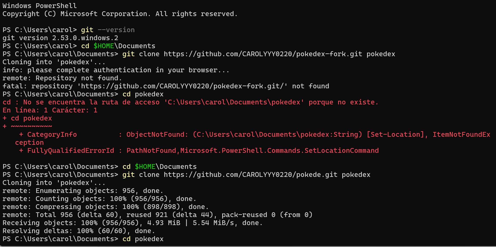
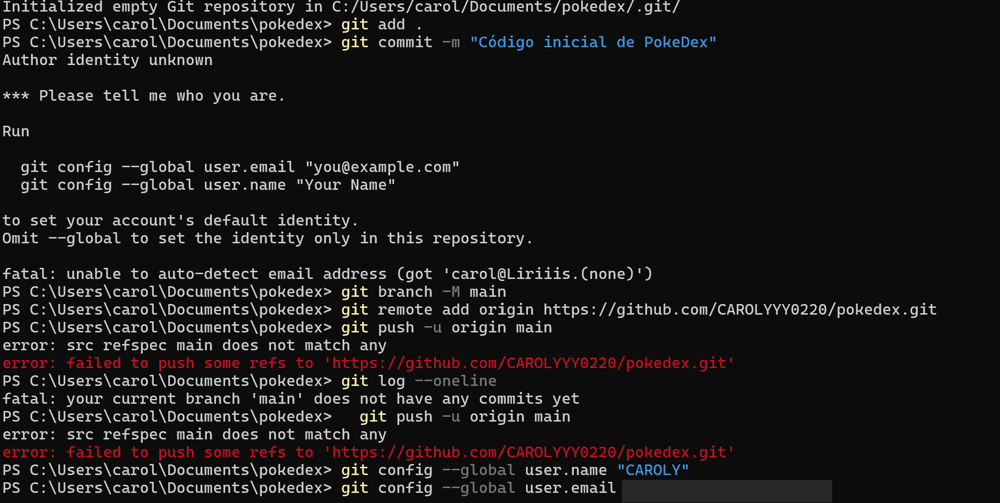
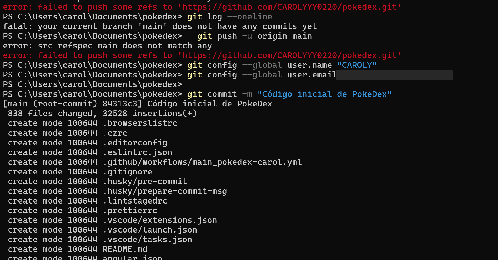
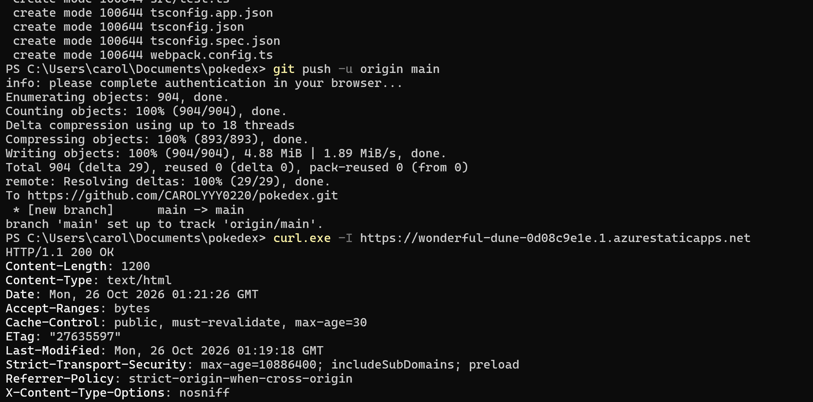
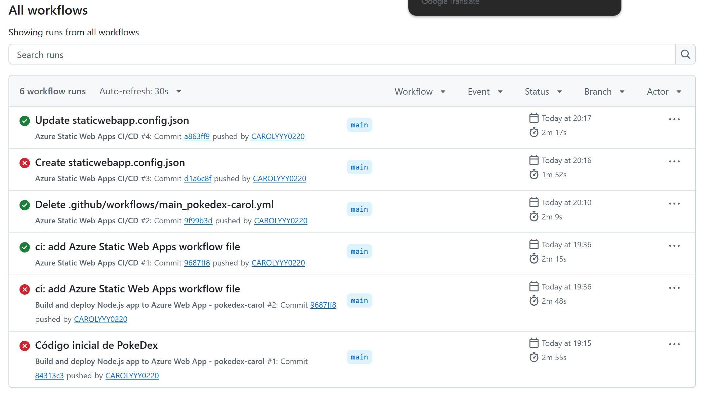
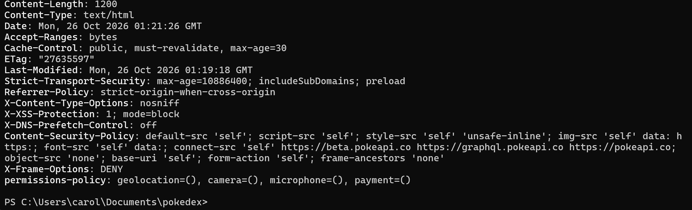
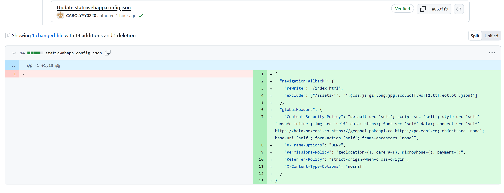
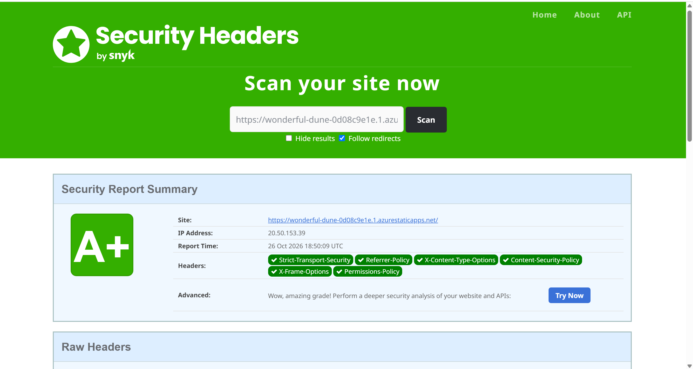

# Despliegue de PokeDex en Azure Static Web Apps

> **Repositorio:** https://github.com/CAROLYYY0220/pokedex
> **URL pública:** https://wonderful-dune-0d08c9e1e.1.azurestaticapps.net
> **Plataforma:** Azure Static Web Apps (plan gratuito) + GitHub Actions
> **Seguridad:** A+ en securityheaders.com
> **Cuenta y configuración inicial en la nube:** ver [README.md](README.md)

Este documento explica cómo se publicó la aplicación PokeDex (Angular) en la nube de Azure: comandos, código usado, errores encontrados y cómo se resolvieron.

---

## 1. Qué se desplegó y por qué esta plataforma

PokeDex es una aplicación **Angular** (SPA). Al compilarla (`dist/pokedex-angular`) produce solo archivos estáticos (HTML, CSS y JavaScript) que consumen la API pública PokéAPI. No tiene servidor propio.

Por eso se eligió **Azure Static Web Apps**: sirve archivos estáticos, se conecta a GitHub, publica automáticamente en cada `push` y permite agregar encabezados de seguridad HTTP con el archivo `staticwebapp.config.json`.

---

## 2. Obtener el código y subirlo a GitHub

Se trabajó desde PowerShell en Windows.

```powershell
# Verificar que Git está instalado
git --version

# Ir a la carpeta de trabajo
cd $HOME\Documents

# Clonar el código fuente de PokeDex en una carpeta llamada "pokedex"
git clone https://github.com/CAROLYYY0220/pokede.git pokedex
cd pokedex

# Borrar el historial de Git original para empezar un repositorio limpio
Remove-Item -Recurse -Force .git

# Crear un repositorio nuevo, agregar todos los archivos y renombrar la rama a "main"
git init
git add .
git branch -M main

# Enlazar con el repositorio "pokedex" creado en GitHub
git remote add origin https://github.com/CAROLYYY0220/pokedex.git

# Configurar la identidad de Git (necesaria para poder hacer commits)
git config --global user.name "TU NOMBRE"
git config --global user.email "TU_CORREO"

# Crear el primer commit (838 archivos) y subirlo a GitHub
git commit -m "Código inicial de PokeDex"
git push -u origin main
```

| Comando | Función |
|---|---|
| `git clone` | Descarga una copia del código fuente. |
| `Remove-Item -Recurse -Force .git` | Elimina el historial anterior para que el repo `pokedex` empiece desde cero. |
| `git init` | Crea un repositorio Git nuevo en la carpeta. |
| `git add .` | Prepara todos los archivos para el commit. |
| `git branch -M main` | Renombra la rama principal a `main`. |
| `git remote add origin` | Enlaza la carpeta local con el repositorio de GitHub. |
| `git config --global user.name / user.email` | Define quién firma los commits. |
| `git commit` | Guarda una versión (commit `84313c3`, 838 archivos). |
| `git push -u origin main` | Sube `main` a GitHub y deja configurado el seguimiento. |

**Evidencia en la terminal**

Clonado del código (primer intento fallido y segundo correcto):



Errores de identidad de Git y de push:



Commit inicial exitoso (commit `84313c3`):



Push exitoso a GitHub y primera verificación con `curl`:



---

## 3. Primer intento: Azure App Service (no funcionó)

Antes de usar Static Web Apps se creó un **Azure App Service (Web App)** llamado `pokedex-carol`, conectado a GitHub desde el portal. Azure generó automáticamente el archivo `.github/workflows/main_pokedex-carol.yml`, que venía incluido en el código clonado.

Al hacer el primer `push` al repositorio nuevo `pokedex`, ese workflow se ejecutó y **falló** (ver problema 4 en la sección 9). Además, App Service está pensado para aplicaciones con servidor, no para una SPA ya compilada, así que se cambió de servicio.

---

## 4. Creación del recurso Azure Static Web Apps

La creación del recurso en el portal (suscripción Azure for Students, grupo de recursos `pokedex`, región Global, plan Gratis, origen GitHub con el repositorio `pokedex` y la rama `main`) está documentada con capturas en [README.md, sección 3](README.md).

Datos de compilación indicados en el asistente:

| Campo | Valor |
|---|---|
| Ubicación de la aplicación | `/` |
| Ubicación de la API | (vacío, no hay backend) |
| Ubicación de salida | `dist/pokedex-angular` |

Al terminar, Azure hizo dos cosas automáticamente:
- Agregó al repositorio el workflow de GitHub Actions (commit `9687ff8`, "ci: add Azure Static Web Apps workflow file").
- Guardó en *Settings → Secrets and variables → Actions* del repositorio el secret `AZURE_STATIC_WEB_APPS_API_TOKEN_WONDERFUL_DUNE_0D08C9E1E`, que autoriza a GitHub a publicar en Azure.

> 📸 **Pendiente:** captura de *Settings → Secrets and variables → Actions* mostrando solo el **nombre** del secret (nunca su valor). Guárdala como `capturas/18-secret-github.png` y reemplaza esta línea por:
> ``

---

## 5. Workflow de despliegue (GitHub Actions)

Archivo: `.github/workflows/azure-static-web-apps-wonderful-dune-0d08c9e1e.yml` *(verifica el nombre exacto en tu repositorio)*.

```yaml
name: Azure Static Web Apps CI/CD

# Cuándo se ejecuta el workflow
on:
  push:
    branches:
      - main                      # Cada push a main compila y publica
  pull_request:
    types: [opened, synchronize, reopened, closed]
    branches:
      - main                      # Los pull requests crean entornos de vista previa

jobs:
  # Trabajo 1: compilar y publicar
  build_and_deploy_job:
    if: github.event_name == 'push' || (github.event_name == 'pull_request' && github.event.action != 'closed')
    runs-on: ubuntu-latest        # Máquina virtual de GitHub
    name: Build and Deploy Job
    steps:
      - uses: actions/checkout@v3 # Descarga el código del repositorio
        with:
          submodules: true
          lfs: false
      - name: Build And Deploy
        id: builddeploy
        uses: Azure/static-web-apps-deploy@v1   # Acción oficial de Azure
        with:
          # Token que autoriza la publicación (guardado como secret, no visible en el código)
          azure_static_web_apps_api_token: ${{ secrets.AZURE_STATIC_WEB_APPS_API_TOKEN_WONDERFUL_DUNE_0D08C9E1E }}
          repo_token: ${{ secrets.GITHUB_TOKEN }}  # Token de GitHub (comentarios en pull requests)
          action: "upload"                         # Subir y publicar el sitio
          app_location: "/"                        # El código fuente está en la raíz del repo
          api_location: ""                         # No hay API/backend
          output_location: "dist/pokedex-angular"  # Carpeta que genera la compilación de Angular

  # Trabajo 2: limpiar el entorno de vista previa al cerrar un pull request
  close_pull_request_job:
    if: github.event_name == 'pull_request' && github.event.action == 'closed'
    runs-on: ubuntu-latest
    name: Close Pull Request Job
    steps:
      - name: Close Pull Request
        id: closepullrequest
        uses: Azure/static-web-apps-deploy@v1
        with:
          azure_static_web_apps_api_token: ${{ secrets.AZURE_STATIC_WEB_APPS_API_TOKEN_WONDERFUL_DUNE_0D08C9E1E }}
          action: "close"
```

**Flujo completo**

```
git push a main
  → GitHub Actions ejecuta el workflow
  → Azure instala dependencias y compila Angular (dist/pokedex-angular)
  → Azure publica los archivos
  → Azure aplica staticwebapp.config.json (encabezados de seguridad y rutas)
  → La app queda disponible en la URL pública
```

---

## 6. Encabezados de seguridad: `staticwebapp.config.json`

Archivo en la **raíz** del repositorio. Azure lo lee en cada despliegue y agrega los encabezados a todas las respuestas.

```json
{
  "navigationFallback": {
    "rewrite": "/index.html",
    "exclude": ["/assets/*", "*.{css,js,gif,png,jpg,ico,woff,woff2,ttf,eot,otf,json}"]
  },
  "globalHeaders": {
    "Content-Security-Policy": "default-src 'self'; script-src 'self'; style-src 'self' 'unsafe-inline'; img-src 'self' data: https:; font-src 'self' data:; connect-src 'self' https://beta.pokeapi.co https://graphql.pokeapi.co https://pokeapi.co; object-src 'none'; base-uri 'self'; form-action 'self'; frame-ancestors 'none'",
    "X-Frame-Options": "DENY",
    "Permissions-Policy": "geolocation=(), camera=(), microphone=(), payment=()",
    "Referrer-Policy": "strict-origin-when-cross-origin",
    "X-Content-Type-Options": "nosniff"
  }
}
```

### 6.1 `navigationFallback`
Angular es una aplicación de una sola página. Si alguien abre directamente una ruta interna (por ejemplo `/pokemon/25`), el servidor no tiene ese archivo y respondería 404. Esta regla devuelve `index.html` para cualquier ruta y Angular decide qué pantalla mostrar. El `exclude` evita aplicarla a archivos reales (CSS, JS, imágenes, fuentes).

### 6.2 `globalHeaders`

| Encabezado | Qué hace en esta aplicación |
|---|---|
| **Content-Security-Policy** | Define desde qué orígenes se carga contenido. Bloquea scripts que no sean propios (defensa contra XSS) y limita las conexiones a PokéAPI. |
| **X-Frame-Options: DENY** | Impide que la página se muestre dentro de un iframe de otro sitio (clickjacking). |
| **Permissions-Policy** | Desactiva geolocalización, cámara, micrófono y pagos, que la app no usa. |
| **Referrer-Policy** | Al navegar a otros sitios, solo se envía el origen, no la URL completa. |
| **X-Content-Type-Options: nosniff** | El navegador respeta el tipo de archivo declarado y no lo "adivina". |

### 6.3 Directivas de la Content-Security-Policy

| Directiva | Significado |
|---|---|
| `default-src 'self'` | Por defecto, solo contenido del propio dominio. |
| `script-src 'self'` | Solo scripts propios; bloquea scripts en línea o de terceros. |
| `style-src 'self' 'unsafe-inline'` | Estilos propios y en línea (Angular los usa). |
| `img-src 'self' data: https:` | Imágenes propias, `data:` y cualquier HTTPS (sprites de los Pokémon). |
| `font-src 'self' data:` | Fuentes propias. |
| `connect-src 'self' https://beta.pokeapi.co https://graphql.pokeapi.co https://pokeapi.co` | La app solo puede hacer peticiones a sí misma y a PokéAPI. |
| `object-src 'none'` | Sin plugins (Flash, etc.). |
| `base-uri 'self'` | Evita que alteren la URL base de la página. |
| `form-action 'self'` | Los formularios solo se envían al propio sitio. |
| `frame-ancestors 'none'` | Nadie puede incrustar la página en un marco. |

### 6.4 Encabezados que agrega Azure por su cuenta
En la verificación (sección 8) aparecen además `Strict-Transport-Security` (HSTS, obliga a usar HTTPS), `X-XSS-Protection` y `X-DNS-Prefetch-Control`. **No se escribieron en el archivo**: los agrega la plataforma. La nota A+ resulta de combinar los cinco encabezados configurados con estos.

Publicar los cambios del archivo:

```powershell
git add staticwebapp.config.json
git commit -m "Update staticwebapp.config.json"
git push
```

---

## 7. Historial de despliegues

Ejecuciones registradas en la pestaña *Actions*:

| Hora | Commit | Workflow | Resultado |
|---|---|---|---|
| 19:15 | `84313c3` Código inicial de PokeDex | Azure Web App - pokedex-carol | ❌ |
| 19:36 | `9687ff8` ci: add Azure Static Web Apps workflow file | Azure Web App - pokedex-carol | ❌ |
| 19:36 | `9687ff8` ci: add Azure Static Web Apps workflow file | Azure Static Web Apps CI/CD | ✅ |
| 20:10 | `9f99b3d` Delete .github/workflows/main_pokedex-carol.yml | Azure Static Web Apps CI/CD | ✅ |
| 20:16 | `d1a6c8f` Create staticwebapp.config.json | Azure Static Web Apps CI/CD | ❌ |
| 20:17 | `a863ff9` Update staticwebapp.config.json | Azure Static Web Apps CI/CD | ✅ |



---

## 8. Verificación del despliegue

URL pública: https://wonderful-dune-0d08c9e1e.1.azurestaticapps.net

Se revisaron los encabezados de la respuesta desde PowerShell:

```powershell
# -I pide solo los encabezados de la respuesta, sin descargar la página
curl.exe -I https://wonderful-dune-0d08c9e1e.1.azurestaticapps.net
```

Resultado (resumido):

```
HTTP/1.1 200 OK
Strict-Transport-Security: max-age=10886400; includeSubDomains; preload
Referrer-Policy: strict-origin-when-cross-origin
X-Content-Type-Options: nosniff
X-XSS-Protection: 1; mode=block
X-DNS-Prefetch-Control: off
Content-Security-Policy: default-src 'self'; script-src 'self'; ...
X-Frame-Options: DENY
permissions-policy: geolocation=(), camera=(), microphone=(), payment=()
```

`200 OK` confirma que la aplicación está publicada, y los encabezados confirman que `staticwebapp.config.json` se aplicó.

| Encabezado | Origen |
|---|---|
| Content-Security-Policy, X-Frame-Options, Permissions-Policy, Referrer-Policy, X-Content-Type-Options | `staticwebapp.config.json` |
| Strict-Transport-Security, X-XSS-Protection, X-DNS-Prefetch-Control | Azure (automático) |



> 📸 **Pendiente:** captura de la aplicación PokeDex funcionando en el navegador, con la URL visible. Guárdala como `capturas/19-app-en-navegador.png` y reemplaza esta línea por:
> ``

---

## 9. Problemas encontrados y soluciones

### Problema 1: `Repository not found` al clonar
- **Síntoma:** `git clone https://github.com/CAROLYYY0220/pokedex-fork.git` respondió `Repository not found`.
- **Causa:** la URL no existía o no era accesible.
- **Solución:** se clonó desde el repositorio correcto (`pokede`). *(Ver captura 09.)*

### Problema 2: `Author identity unknown` al hacer commit
- **Síntoma:** `git commit` pidió identificarse y no creó el commit.
- **Causa:** Git no tenía configurados nombre ni correo.
- **Solución:** `git config --global user.name` y `git config --global user.email`. *(Ver captura 10.)*

### Problema 3: `src refspec main does not match any` al hacer push
- **Síntoma:** `git push -u origin main` falló.
- **Causa:** consecuencia del problema 2: como el commit no se había creado, la rama `main` no tenía commits que subir.
- **Solución:** se repitió el commit (con la identidad configurada) y luego el push. *(Ver capturas 10, 11 y 12.)*

### Problema 4: fallo del login en el workflow de Azure Web App
- **Síntoma:** el workflow "Build and deploy Node.js app to Azure Web App - pokedex-carol" falló en el paso de login con: `Login failed with Error: Using auth-type: SERVICE_PRINCIPAL. Not all values are present. Ensure 'client-id' and 'tenant-id' are supplied.`
- **Causa:** el workflow lo generó Azure al crear el App Service conectado al repositorio anterior. Al subir el código a un repositorio nuevo, el archivo `.yml` se copió, pero los *secrets* de autenticación (client-id, tenant-id, subscription-id) no, porque pertenecen a cada repositorio. Además, App Service no es el servicio adecuado para una SPA estática.
- **Solución:** se usó Azure Static Web Apps (sección 4) y se eliminó el workflow antiguo (commit `9f99b3d`), para que cada push ejecute un solo workflow.

> 📸 **Pendiente:** captura del log del error de login (ejecución fallida del Web App, paso en rojo). Guárdala como `capturas/20-error-login-azure.png` y reemplaza esta línea por:
> ``

### Problema 5: despliegue fallido al crear `staticwebapp.config.json`
- **Síntoma:** la ejecución #3 ("Create staticwebapp.config.json", commit `d1a6c8f`) falló.
- **Causa:** el archivo se creó **vacío**, sin contenido. Azure Static Web Apps lee este archivo en cada despliegue y espera un JSON válido.
- **Solución:** en el commit `a863ff9` se agregó el contenido completo (13 líneas). La ejecución #4 terminó correctamente.



### Avisos no bloqueantes del workflow
Las ejecuciones exitosas muestran 2 *warnings* y 1 *notice* que no impiden el despliegue:
- `actions/checkout@v3` usa Node.js 20, en desuso; GitHub lo ejecuta con Node.js 24.
- No se pudo eliminar `http.https://github.com/.extraheader` de la configuración de git (paso de limpieza).
- Aviso de que la etiqueta `ubuntu-latest` migrará a Ubuntu 26 desde el 19/10/2026.

---

## 10. Seguridad de la aplicación

### 10.1 securityheaders.com
1. Entrar a https://securityheaders.com/
2. Escribir la URL pública: `https://wonderful-dune-0d08c9e1e.1.azurestaticapps.net`
3. Pulsar **Scan**.

**Resultado: A+**

El escaneo se realizó el 26/10/2026 (18:50 UTC) y reconoció los seis encabezados de seguridad: Strict-Transport-Security, Referrer-Policy, X-Content-Type-Options, Content-Security-Policy, X-Frame-Options y Permissions-Policy.



### 10.2 (Opcional, +5 puntos) SSL Labs
1. Entrar a https://www.ssllabs.com/ssltest/
2. Escribir el dominio `wonderful-dune-0d08c9e1e.1.azurestaticapps.net`.
3. Marcar *Do not show the results on the boards* y pulsar **Submit**.

**Resultado:** `[nota obtenida]`

> 📸 **Pendiente (opcional):** captura del resultado. Guárdala como `capturas/22-ssl-labs.png`.
>
> *(Si no realizas esta prueba, elimina esta subsección.)*

---

## 11. Cómo actualizar la aplicación después

```powershell
git add .
git commit -m "Descripción del cambio"
git push
```

Al hacer `push` a `main`, GitHub Actions compila y Azure publica la nueva versión automáticamente. El estado se revisa en la pestaña *Actions* del repositorio.

---

## 12. Conclusiones

- La aplicación quedó publicada y accesible en una URL pública con HTTPS.
- El despliegue es automático: cada `push` a `main` actualiza el sitio.
- Los encabezados de seguridad viajan en el propio repositorio (`staticwebapp.config.json`), por lo que se aplican en cada despliegue.
- La combinación de los encabezados configurados y los que agrega Azure produjo la nota **A+** en securityheaders.com.
- Elegir el servicio adecuado (Static Web Apps en lugar de App Service) simplificó el despliegue.
