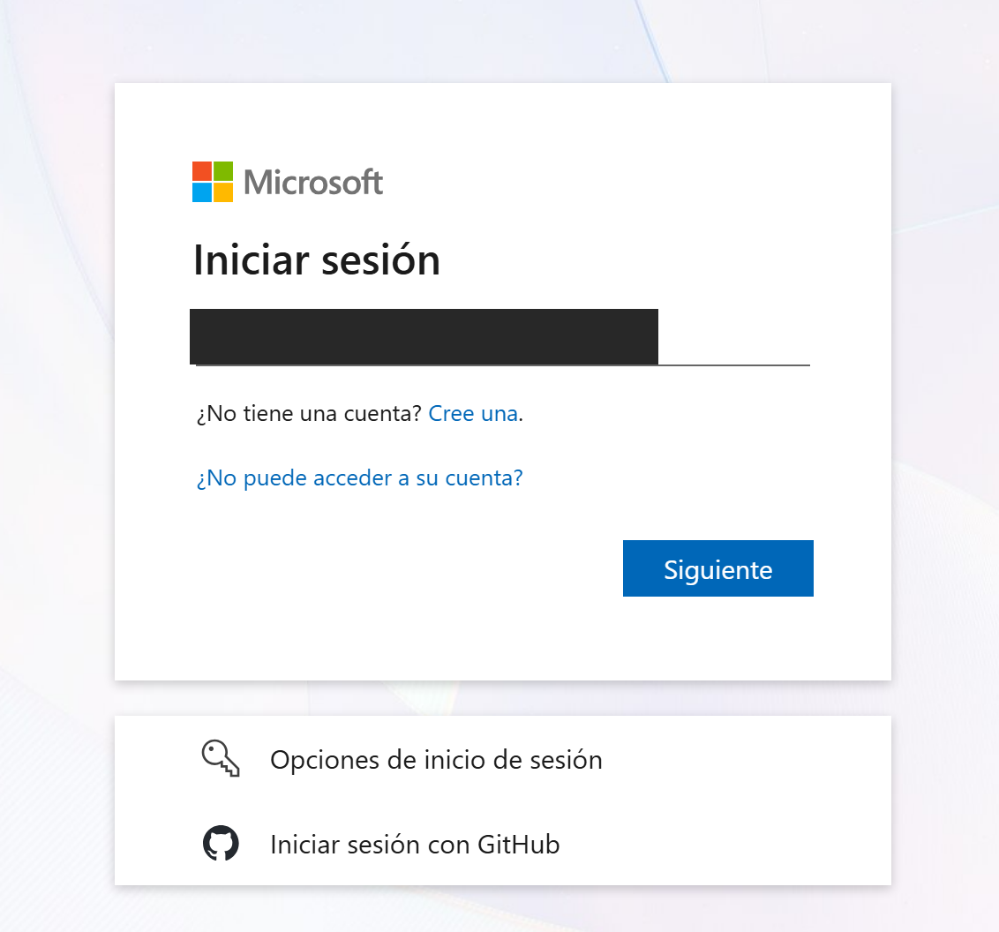
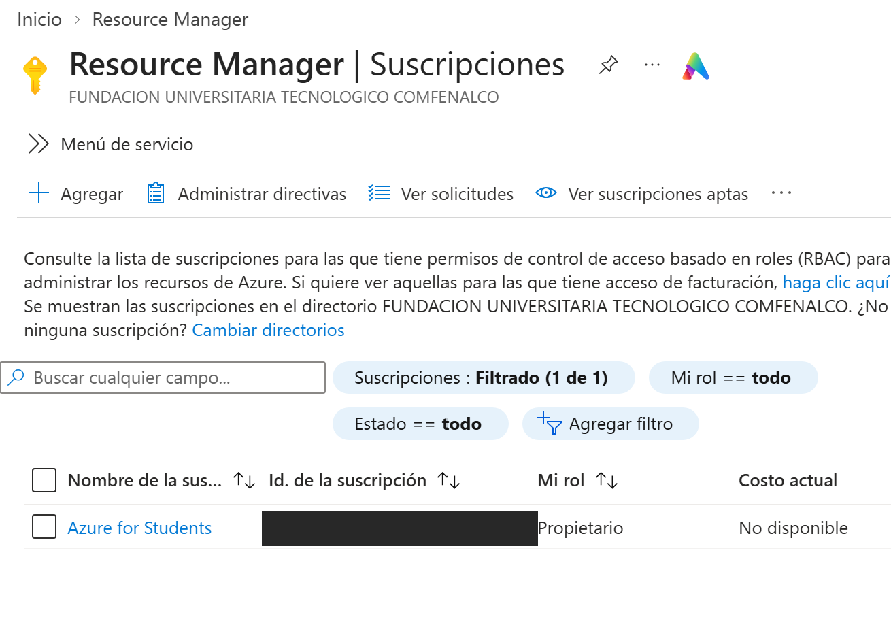
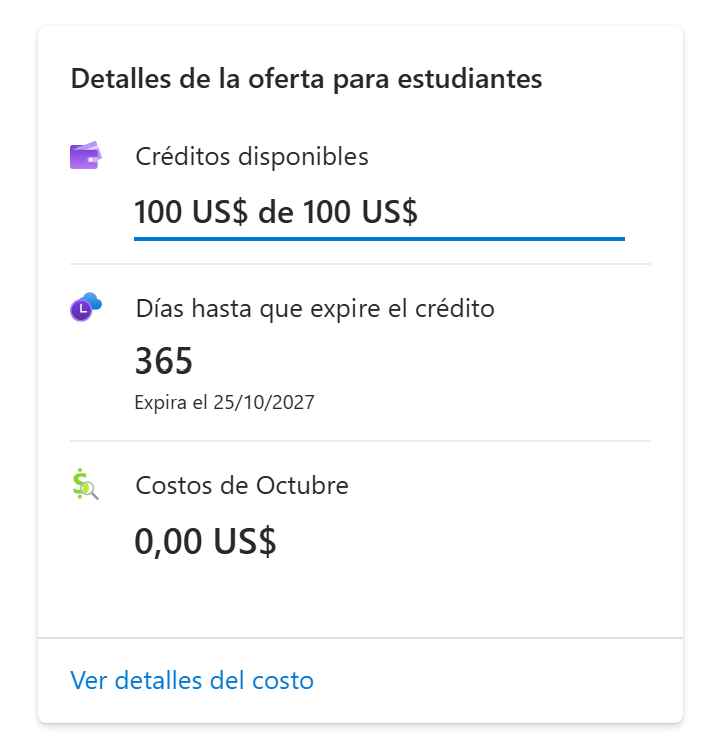
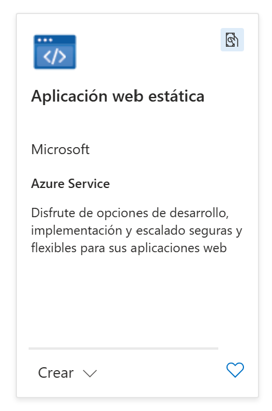
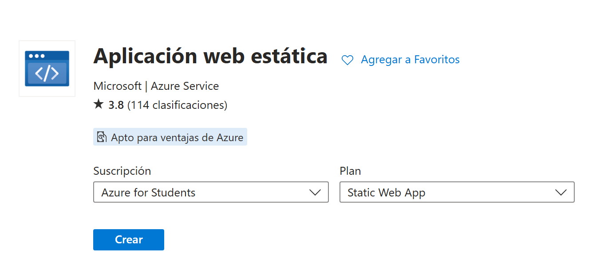
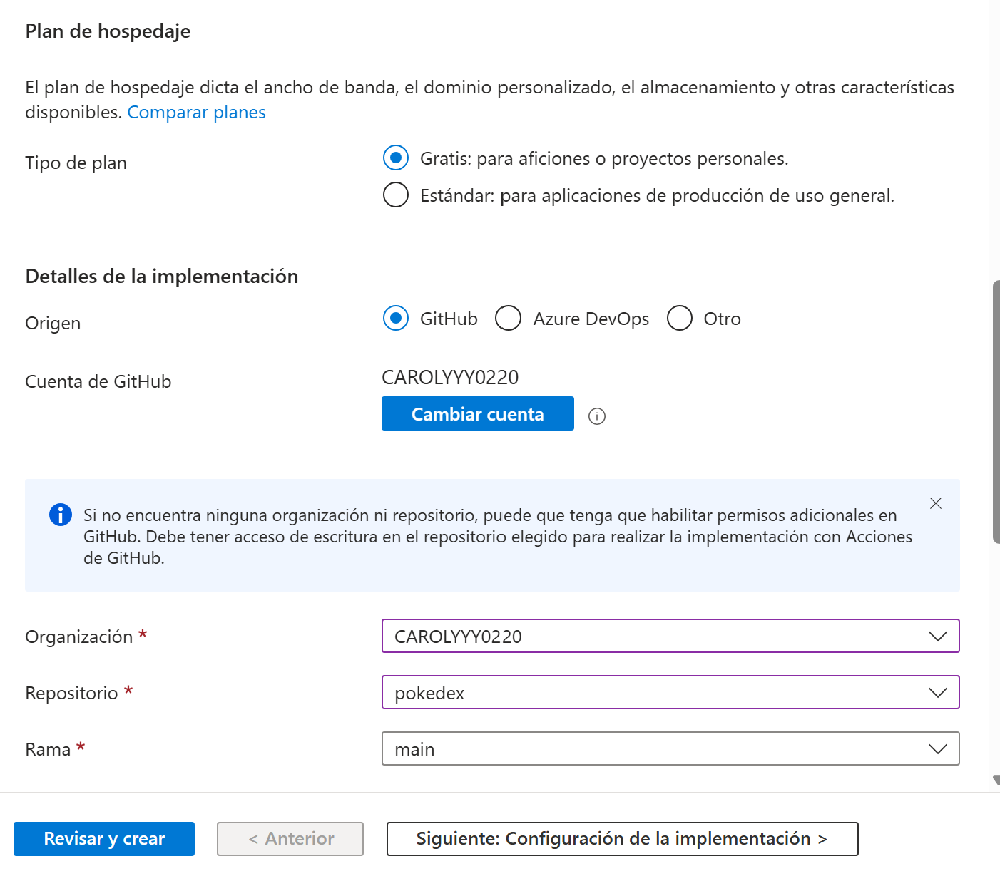
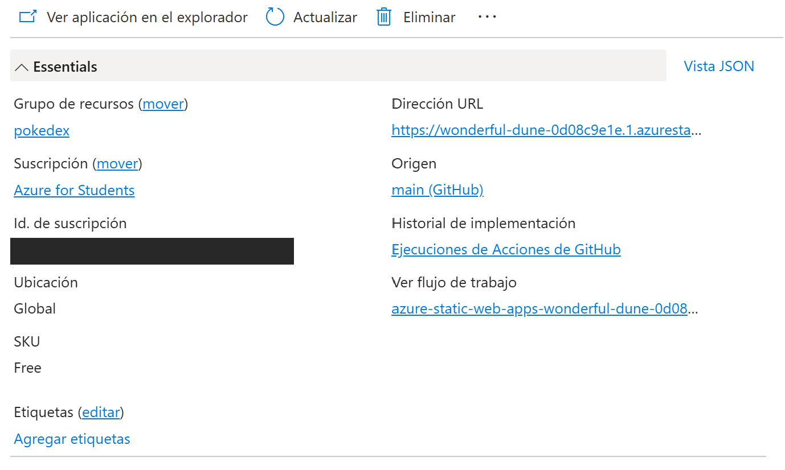

# PokeDex en la nube: cuenta de Azure y configuración inicial

> **Repositorio:** https://github.com/CAROLYYY0220/pokedex
> **Aplicación publicada:** https://wonderful-dune-0d08c9e1e.1.azurestaticapps.net
> **Plataforma:** Microsoft Azure (Azure Static Web Apps, plan gratuito)
> **Documento complementario:** [Despliegue.md](Despliegue.md) (cómo se publicó la aplicación)

Este documento explica, paso a paso, cómo se creó la cuenta en la nube pública utilizada y cómo se hizo la configuración inicial antes de desplegar la aplicación PokeDex de Pueblo Paleta Inc.

| Campo | Valor |
|---|---|
| Nube pública | Microsoft Azure |
| Tipo de cuenta | Azure for Students (correo institucional) |
| Servicio | Azure Static Web Apps |
| Plan | Gratis (Free) |
| Grupo de recursos | `pokedex` |
| Región | Global |
| Origen del código | GitHub (`CAROLYYY0220/pokedex`, rama `main`) |
| Autor | `[Tu nombre]` |

---

## 1. Plataforma elegida y por qué

Se eligió **Microsoft Azure** porque:

- **Azure for Students** permite crear una cuenta gratuita con el correo institucional, con un crédito inicial para probar servicios.
- Incluye **Azure Static Web Apps**, un servicio pensado para aplicaciones web estáticas como PokeDex (Angular compilado), con plan gratuito y distribución global.
- Se conecta con GitHub y publica automáticamente cada cambio que se sube al repositorio.
- Permite configurar encabezados de seguridad HTTP, requisito de la compañía.

---

## 2. Creación de la cuenta de Azure

1. Entrar a https://azure.microsoft.com/free/students y pulsar **Activar ahora**.
2. Iniciar sesión con la cuenta Microsoft asociada al **correo institucional** (`@tecnoconfenalco.edu.co`). Azure for Students exige un correo de una institución educativa.

   

3. Completar la verificación de estudiante y los datos del perfil que pide Azure. `[Describe aquí lo que te pidió: código al correo, teléfono, etc.]`
4. Al terminar, el portal https://portal.azure.com queda con la suscripción **Azure for Students** activa. Se comprueba en **Suscripciones**: aparece la suscripción con el rol **Propietario**, dentro del directorio de la institución.

   

5. En la página de la suscripción se ven los **detalles de la oferta para estudiantes**: 100 US$ de crédito disponible, 365 días de vigencia (hasta el 25/10/2027) y costos de octubre en 0,00 US$.

   

---

## 3. Configuración inicial: crear el recurso Static Web App

### 3.1 Buscar el servicio
En el portal, desde **Crear un recurso**, se busca **Aplicación web estática** (Static Web Apps) y se pulsa **Crear**.

Se confirma la suscripción (**Azure for Students**) y el plan (**Static Web App**).

### 3.2 Datos básicos
| Campo | Valor elegido | Por qué |
|---|---|---|
| Suscripción | Azure for Students | Es la suscripción gratuita de estudiante. |
| Grupo de recursos | `pokedex` | Agrupa los recursos del proyecto, como una carpeta. |
| Región de hospedaje | Global | Static Web Apps distribuye los archivos estáticos globalmente. |

### 3.3 Plan de hospedaje y origen del código
| Campo | Valor elegido | Por qué |
|---|---|---|
| Tipo de plan | Gratis | Es un proyecto académico, no necesita el plan estándar. |
| Origen | GitHub | El código ya está en un repositorio de GitHub. |
| Cuenta / organización | `CAROLYYY0220` | Cuenta de GitHub autorizada para Azure. |
| Repositorio | `pokedex` | Repositorio solicitado por el caso de estudio. |
| Rama | `main` | Rama que se publica automáticamente. |

### 3.4 Detalles de compilación
En la pestaña **Configuración de la implementación** se indican los datos para compilar Angular: ubicación de la app `/` y ubicación de salida `dist/pokedex-angular`.

> 📸 **Pendiente:** captura de la pestaña *Configuración de la implementación / Detalles de compilación* (preset, ubicación de la app y de salida). Guárdala como `capturas/17-detalles-compilacion.png` y reemplaza esta línea por:
> ``

### 3.5 Revisar y crear
Se pulsa **Revisar y crear** y luego **Crear**. Azure agrega automáticamente al repositorio el workflow de GitHub Actions y guarda en GitHub el secret con el token de despliegue.

---

## 4. Verificación de la configuración

Terminada la creación, el recurso muestra su información esencial: grupo de recursos `pokedex`, suscripción Azure for Students, ubicación Global, SKU **Free**, origen `main (GitHub)`, la URL pública y el enlace al workflow generado (`azure-static-web-apps-wonderful-dune-0d08...`).

En la vista general de la aplicación el estado es **Listo**, el entorno **Producción** y el dominio es la URL pública.

URL final: **https://wonderful-dune-0d08c9e1e.1.azurestaticapps.net**

---

## 5. Recomendaciones de seguridad de la cuenta

- No subir al repositorio contraseñas, tokens ni claves; los secretos se guardan en *Settings → Secrets and variables → Actions* de GitHub.
- Activar la verificación en dos pasos en la cuenta Microsoft y en GitHub.
- Revisar periódicamente el consumo y eliminar recursos que ya no se usen (por ejemplo, el App Service que se descartó, ver Despliegue.md).
- Antes de publicar capturas, ocultar correos, identificadores de suscripción y cualquier dato personal.

---

## 6. Siguientes pasos

La publicación de la aplicación, los comandos, el código del workflow, los encabezados de seguridad, los problemas encontrados y el resultado **A+** en securityheaders.com están en [Despliegue.md](Despliegue.md).
