# PokeDex en Azure Static Web Apps

Aplicación **PokeDex (Angular 14)** desplegada en Microsoft Azure para la compañía Pueblo Paleta Inc.

- **Aplicación publicada:** https://wonderful-dune-0d08c9e1e.1.azurestaticapps.net
- **Repositorio:** https://github.com/CAROLYYY0220/pokedex
- **Servicio de nube:** Azure Static Web Apps
- **Automatización:** GitHub Actions
- **Resultado reportado en SecurityHeaders:** A+

## Documentación

- [Instalación y ejecución local](docs/instalacion.md)
- [Despliegue en Azure](pokedex/despliegue.md)
- [Configuración de seguridad](docs/seguridad.md)
- [Paso a paso original](docs/paso-a-paso.md)

## Tecnologías

- Angular 14
- Apollo Client / GraphQL
- PokéAPI
- GitHub
- GitHub Actions
- Azure Static Web Apps

## Descripción

El proyecto consiste en una aplicación PokeDex que consulta información de Pokémon mediante PokéAPI. La aplicación se publica en Azure Static Web Apps y se configura un flujo de integración y despliegue continuo asociado al repositorio de GitHub.

## Repositorio y despliegue

El detalle de la creación del repositorio, la configuración de Azure, los parámetros de compilación y la comprobación del despliegue se encuentra en [la guía de despliegue](docs/despliegue.md).

## Seguridad

La configuración de encabezados HTTP se documenta en [Configuración de seguridad](docs/seguridad.md). El resultado A+ en SecurityHeaders es el resultado consignado en la documentación del proyecto; conviene volver a ejecutar el análisis si se necesita una verificación actualizada.

## Capturas de pantalla

Las siguientes imágenes se extrajeron del documento original y se incluyen en la carpeta `img/`.

### Captura 01

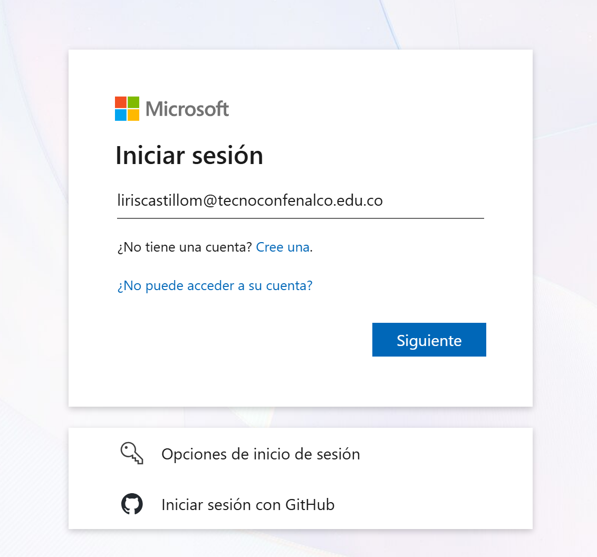

### Captura 02

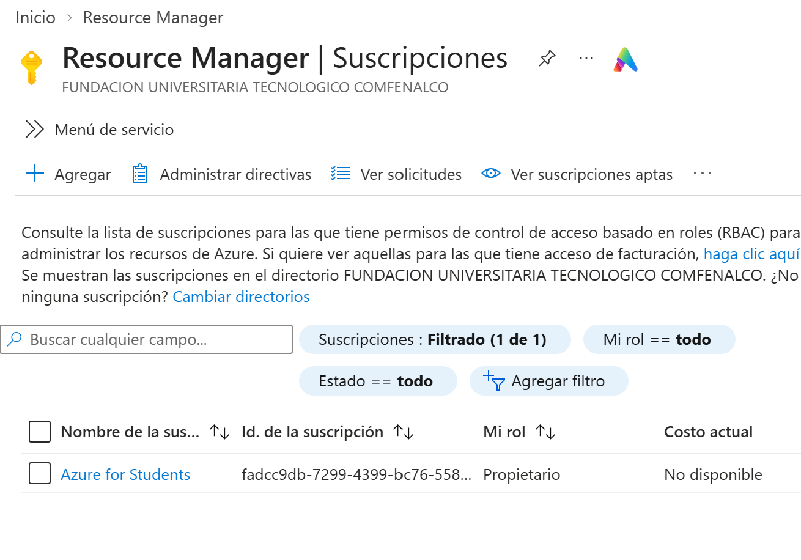

### Captura 03

### Captura 04

### Captura 05

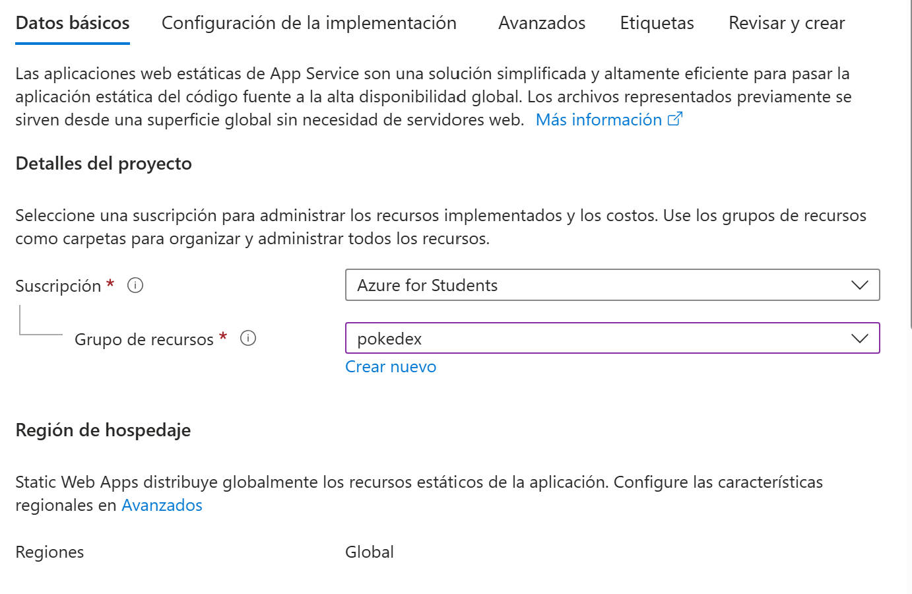

### Captura 06

### Captura 07

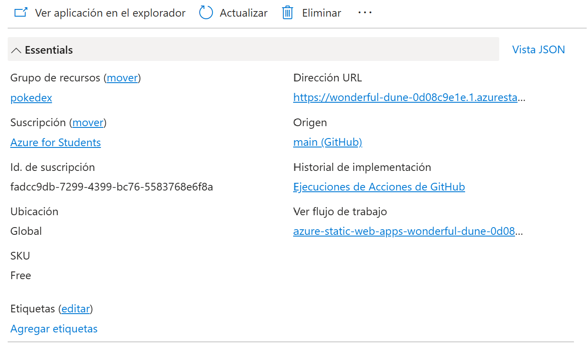

### Captura 08

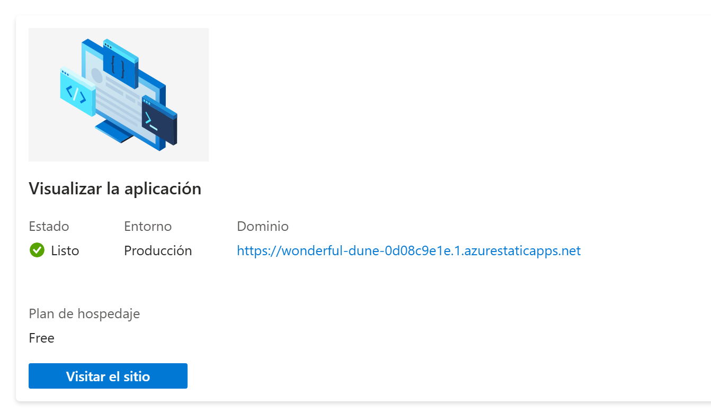

### Captura 09

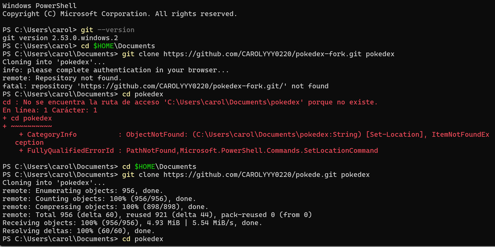

### Captura 10

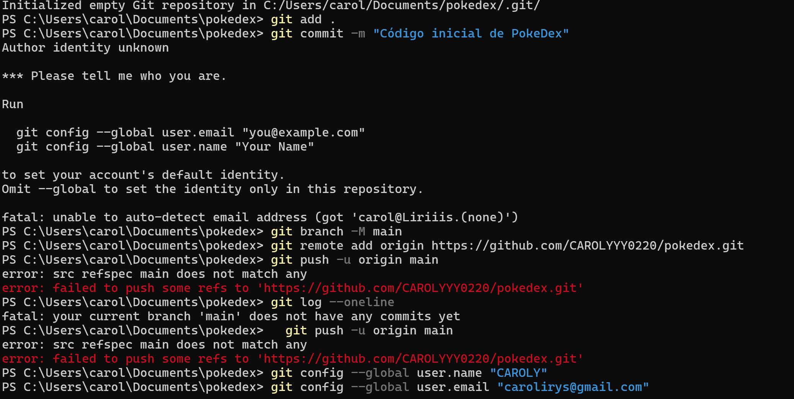

### Captura 11

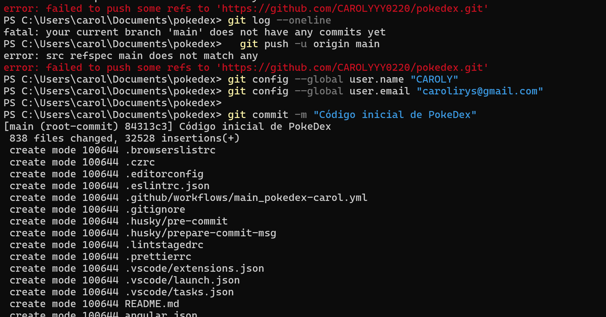

### Captura 12

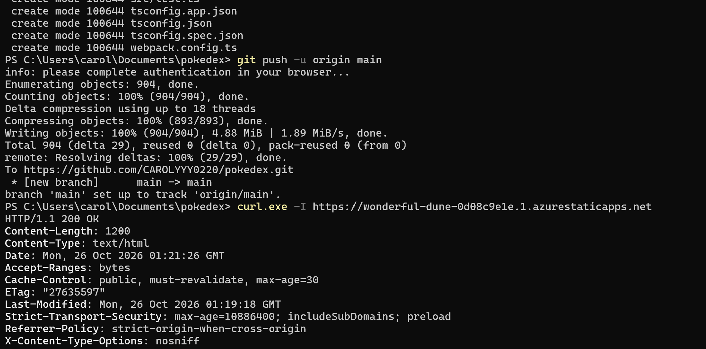

### Captura 13

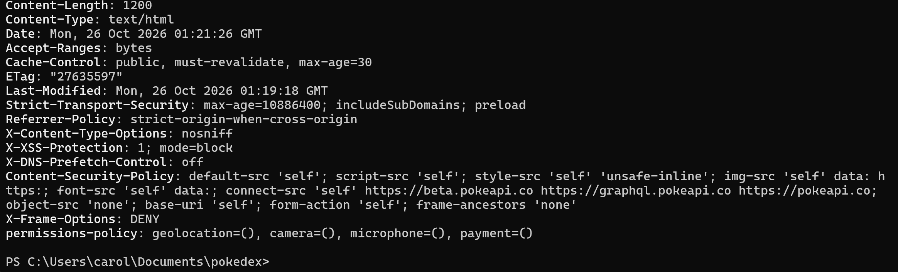

### Captura 14

### Captura 15

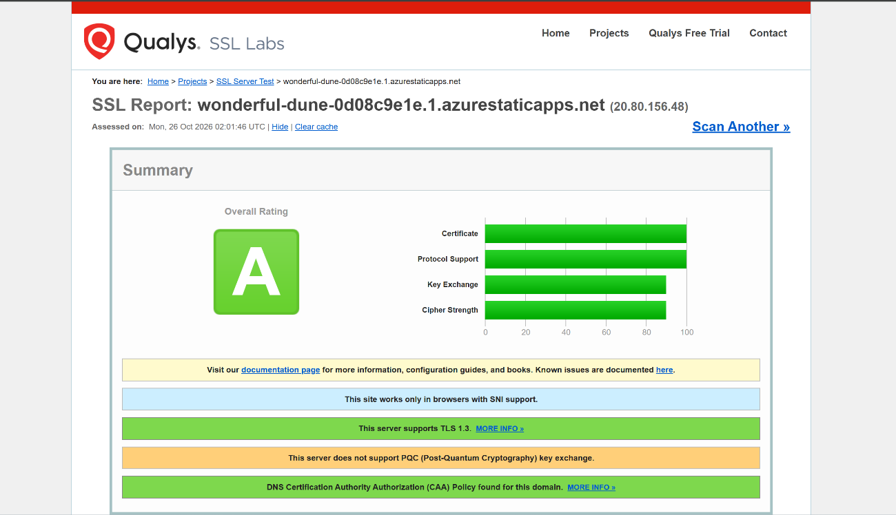

### Captura 16

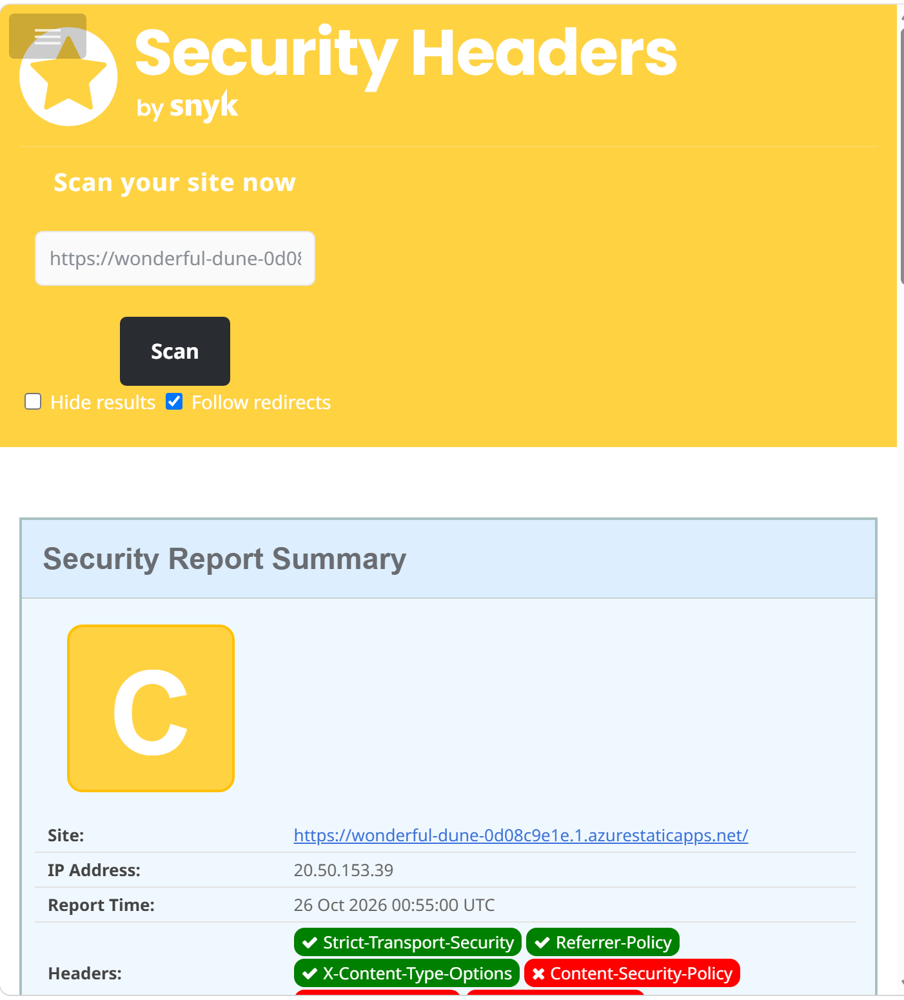

### Captura 17

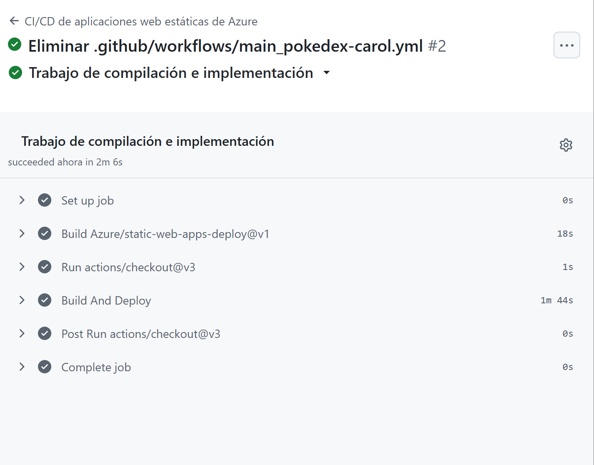

### Captura 18

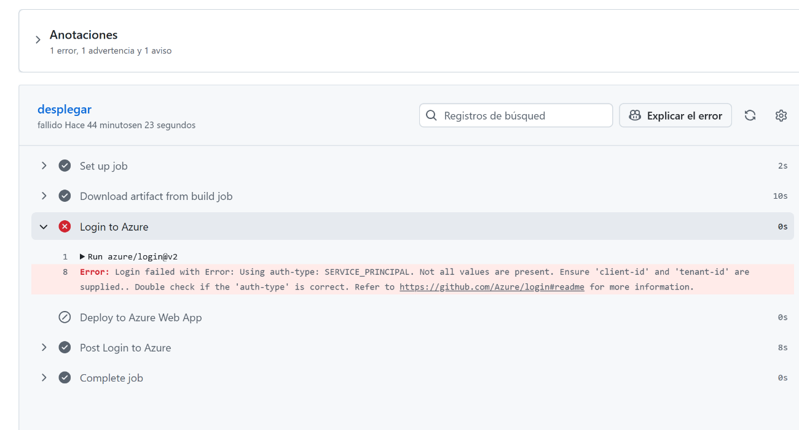

### Captura 19

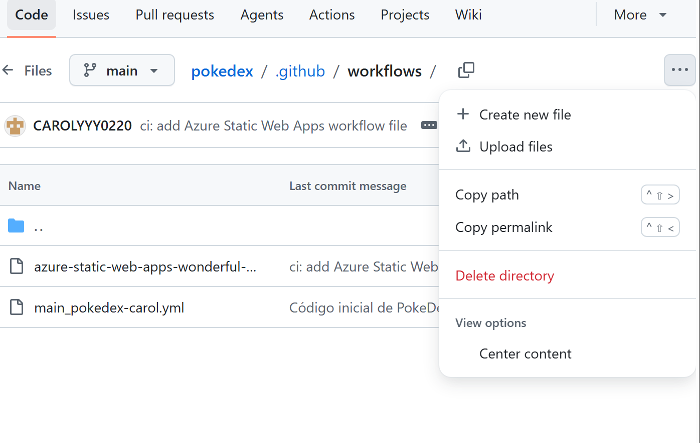

### Captura 20

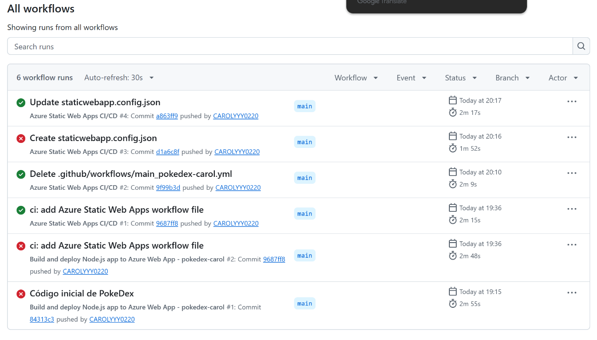

